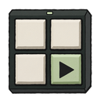
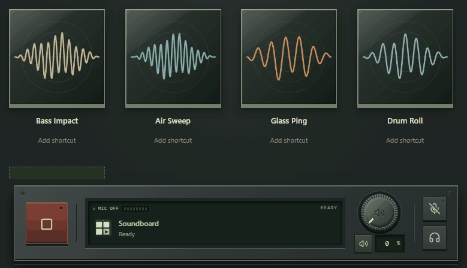
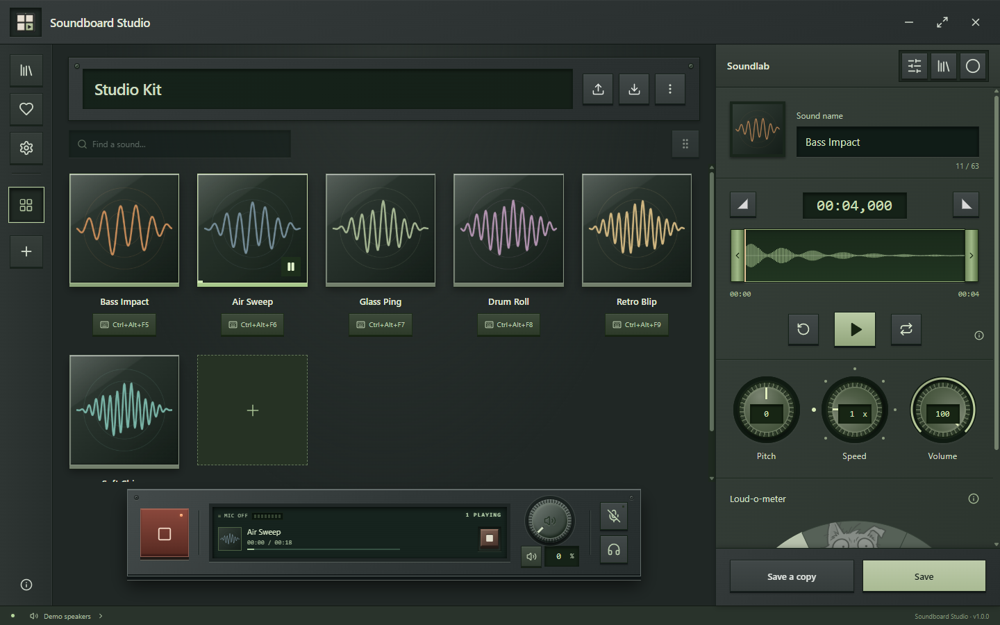
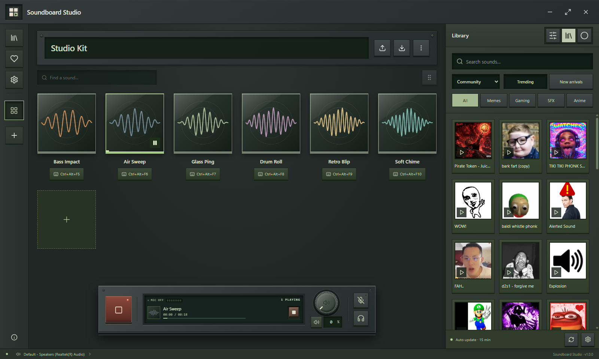
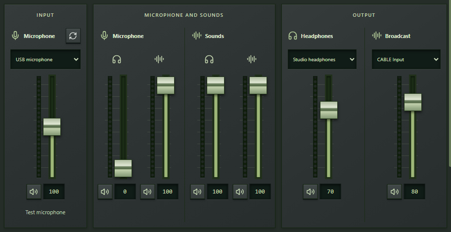

<p align="center"></p>
<h1 align="center">Soundboard Studio for Windows</h1>
<p align="center">Built by <strong>Qu4nh</strong> · Windows x64 · <a href="LICENSE">PolyForm Noncommercial</a> · <a href="docs/guide.vi.md">Tiếng Việt</a></p>

**Play a clip into your call. Hear the next one privately.** Soundboard Studio is a Windows soundboard that mixes your mic and pads into one virtual microphone. Use global hotkeys while you're in a game, then quit and get your previous Windows mic back if auto-switch is enabled.

[Get started](#download-and-run-on-windows) · [Audio setup](#play-soundboard-clips-through-your-microphone) · [Benchmarks](#performance) · [Engineering](#engineering)

## Engineering

- **Recoverable Windows mic switching.** The app journals the capture defaults for Console, Multimedia, and Communications before switching. A watchdog handles unexpected exits. Recovery checks each role before restoring it to preserve later user choices. Tests cover a partially failed switch and concurrent start requests. [Audio session](desktop/audio-session.cjs) · [Windows endpoint helper](desktop/windows-audio.ps1) · [Recovery tests](tests/audio-session.test.cjs)
- **Separate monitor and broadcast paths.** A board clip can reach both outputs while a Library or Soundlab preview stays on the physical listening device. If only virtual outputs are available, preview stays muted. Echo cancellation runs on the mic before it joins the broadcast mix. [Audio engine](src/audio.js) · [Preview routing](src/preview-routing.js) · [Audio tests](tests/audio.test.cjs)
- **Playback continues when minimized.** A minimized 240-pad board kept three clips playing with no UI progress ticks and **0.31 ms of renderer task time per second** in the recorded sample. [Renderer benchmark](docs/benchmarks.md#playback-interface)
- **Per-instance playback and progress.** Global key-down and key-up events drive hold-to-loop. Playback state identifies each instance independently, so two copies of the same clip can be stopped separately. Progress updates go to the dock and active pads and pause when the window is hidden. [Playback state](src/playback-display.js) · [Playback tests](tests/audio.test.cjs)
- **PCM capture and editing.** Instant Replay encodes the requested range directly from buffered PCM. Soundlab loads on demand and renders edits offline. WAV saves cross the Electron preload bridge as typed bytes. [Recorder](src/recorder.js) · [Soundlab rendering](src/soundlab-audio.js) · [Benchmark script](scripts/benchmark-replay.mjs)

Run `npm run verify` to exercise mic rollback, playback races, preview isolation, catalog redirect handling, and recovery of damaged library metadata before building. [Architecture and audio routing diagram](docs/architecture.md) · [Automated tests](tests/) · [Windows CI workflow](.github/workflows/ci.yml)



*Recorded in Soundboard Studio with sample clips. The demo is silent.*

## First launch

1. Open the portable EXE and drag two audio files onto a board. Local playback works without a virtual mic.
2. Right-click a pad to assign a global shortcut, then use it with another app in focus. Play both clips together and stop one from its card in the dock.
3. For voice chat, set up VB-CABLE. Run the live mic check, then try a Library preview. The virtual mic carries your voice and played pads while previews go to your listening device.

Missed a sound you wanted to keep? Enable **Instant Replay** before a session to save up to the last **45 seconds** of microphone or system audio as WAV. Trim it into a new pad in **Soundlab**.

## Download and run on Windows

Use the Windows x64 portable `.exe` from **Releases** when a release is available. To run from source, install [Node.js 24](https://nodejs.org/) and [Git](https://git-scm.com/downloads), then run these commands from the repository root.

```powershell
npm ci
npm run build
npm start
```

Use `npm run dev` for development, `npm run verify` for tests and a production build, or `npm run package` to create a portable EXE in `release/`.

## Soundboard features

- **Play and control.** Build boards from local clips. Assign global hotkeys for overlap, pause, stop, restart, or hold-to-loop. The dock shows every active clip and lets you stop a single instance or all playback.
- **Mix and monitor.** Adjust mic and sound levels independently for speakers or headphones and for the broadcast output. Route the broadcast through VB-CABLE, then verify the virtual input with a live meter and a five-second listen-back.
- **Edit in Soundlab.** Trim and fade a clip against its waveform, change pitch independently of speed, adjust loudness, and preview locally. Save the edit as WAV in place or as a copy.
- **Record and recover.** Capture microphone, system audio, or both. Preview and trim a take before saving it to a board. Instant Replay keeps up to 45 seconds in memory and can produce separate WAVs for the mic, system audio, and their mix.
- **Collect and share.** Search and filter the automatically refreshed community catalog, browse trending and recent sounds, and keep clips for offline playback. Import or export complete boards with their audio and cover art.

The interface is available in English and Vietnamese.

### Soundlab



### Community Library



*Trending sounds and cover art from the live Community catalog.*

## Play soundboard clips through your microphone

Open **Settings → Audio → Virtual microphone** to configure VB-CABLE for voice chat or streaming. Select **CABLE Output** as the microphone in the receiving app, or use its system default input with auto-switch enabled. Soundboard Studio saves and restores the Windows microphone defaults when you use auto-switch. Local playback works without VB-CABLE. [Virtual microphone setup in Vietnamese](docs/guide.vi.md#dùng-mic-ảo)

You can keep listening through your speakers while your microphone is active. Enable **Advanced Settings → Speaker Echo Cancellation** to reduce speaker sound picked up by the microphone. Library previews go only to your local listening device.

The broadcast mix goes directly from Web Audio to the selected output device. [VB-CABLE latency measurements](docs/benchmarks.md#virtual-microphone-latency)



*Mixer shown with demo devices.*

## Performance

| Workload | Measured |
| --- | --- |
| Idle with the window open | **130–133 MiB** private working set across three launches. **0.05% CPU** on average across all logical processors. |
| Play three 45-second stereo clips together | **1.35% CPU** on average across all logical processors |
| Save a 45-second stereo edit with pitch shift in Soundlab | **1.94 s** from clicking **Save a copy** to the new pad appearing |
| Encode 45 seconds of Instant Replay for mic, system audio, and the mix | **168 ms** median |
| Play three clips on a minimized 240-pad board | **0.31 ms** of renderer task time per second |

Soundlab loads on demand, and a **64 MiB** decoded-audio cache keeps recently played clips ready. When the window is minimized, audio and global hotkeys stay active while visual progress updates pause.

Measured on Soundboard Studio **v1.0.0** with synthetic audio on an Intel Core i7-10700K running Windows x64. Mic mixing and Instant Replay were off in the idle test. [Memory measurements and benchmark methods](docs/benchmarks.md)

## Project

[Security](SECURITY.md)

You may use, modify, and redistribute the project code for noncommercial purposes. Keep the original attribution to Qu4nh and include the license or its URL when distributing copies, including modified versions. Contact Qu4nh for separate commercial permission. [PolyForm Noncommercial 1.0.0](LICENSE)

Community catalog media and the optional VB-CABLE driver retain their respective terms.
