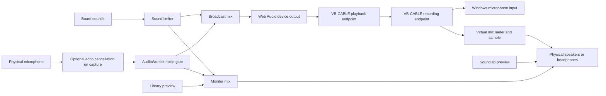

# Architecture

Soundboard Studio runs as a Windows desktop app. The Electron main process owns the sound library, global key bindings, file dialogs, and Windows microphone session. The sandboxed React renderer owns the audio graph and the interface.

## Audio paths

The diagram represents a configured VB-CABLE session. The engine can also use regular playback devices. The broadcast mix goes straight to the audio context's selected output when `AudioContext.setSinkId()` is available. The monitor mix keeps its own device and media element. Preview and listen-back share the physical-device routing policy, while Soundlab and the mic test use separate players. When monitor and broadcast resolve to the same sink, the engine avoids duplicating board audio on the monitor path.

With Speaker Echo Cancellation enabled, the app requests echo cancellation from Chromium on the mic capture stream. The mic signal then passes through the AudioWorklet noise gate. Pad audio enters the broadcast mix through its own branch, downstream of mic processing.

## Where to read the code

| Area | Entry point |
| --- | --- |
| Windows desktop, native hotkeys, IPC | [`desktop/main.cjs`](../desktop/main.cjs) and [`desktop/preload.cjs`](../desktop/preload.cjs) |
| Playback, routing, and decoded PCM cache | [`src/audio.js`](../src/audio.js) and [`src/preview-routing.js`](../src/preview-routing.js) |
| Dock and pad progress | [`src/playback-display.js`](../src/playback-display.js) |
| Soundlab rendering and capture | [`src/soundlab-audio.js`](../src/soundlab-audio.js) and [`src/recorder.js`](../src/recorder.js) |
| Default-mic recovery | [`desktop/audio-session.cjs`](../desktop/audio-session.cjs) and [`desktop/windows-audio.ps1`](../desktop/windows-audio.ps1) |
| Local library and community catalog | [`desktop/store.cjs`](../desktop/store.cjs) and [`desktop/community.cjs`](../desktop/community.cjs) |

## Windows mic lifecycle

The app prepares the broadcast route and identifies the physical mic before activating the virtual session. Activation records the Windows console, multimedia, and communications capture defaults in a local journal. The watchdog observes the app process, while orderly quit uses the same restore logic. Recovery checks the current endpoint for each role before restoring it, so a later manual Windows device selection is respected.

The virtual mic test opens the exact capture endpoint, measures PCM, and holds the five-second sample in memory. Listen-back requires a physical output resolved by the preview router. It uses the configured monitor mute and volume.

## Disk and process boundaries

- The preload exposes a small set of named IPC operations and events. The renderer remains isolated from Node.js and the filesystem.
- WAV saves use a `Uint8Array` over IPC. Library metadata is persisted through a queued temporary-file write and rename. Native device selections and recovery metadata are separated from the portable library.
- The catalog client restricts requested hosts and redirects. The app caches fetched content locally and retains attribution. Catalog availability depends on the provider.
- Web Audio owns playback time. Native window visibility controls progress and meter updates so a hidden window can continue to process playback and global hotkeys.
